# 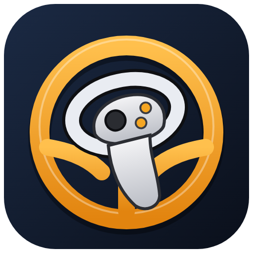 ETS2 ATS VR Controls

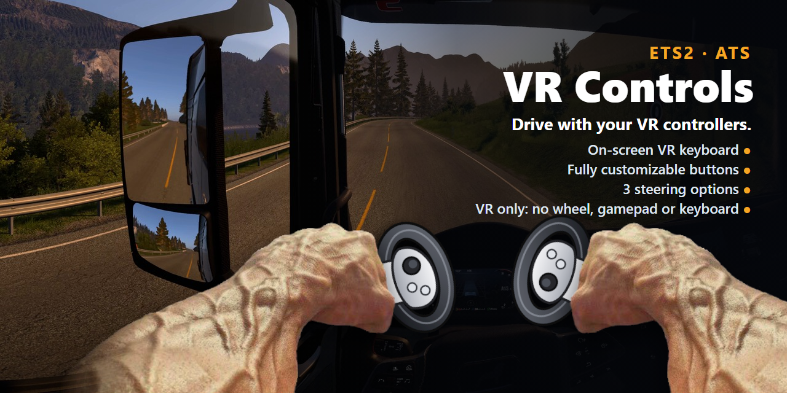

Play **Euro Truck Simulator 2** and **American Truck Simulator** in VR with **only your headset and its own controllers**.
No steering wheel, no gamepad, no keyboard, no mouse, no extra hardware.

- **Drive with the controllers:** three ways to steer -- a stick (smooth, like a gamepad), a **two-hand wheel** (hold both
  grips and turn your hands) or **pointing** with one controller. The triggers are gas and brake.
- **Every key on a button:** indicators, horn, lights, anything, in **four layers** (hold the right grip, the left grip or
  both for more buttons). Pick the keys in a menu in the headset.
- **A mouse in your hand:** a stick or the controller's aim moves the pointer, a button clicks. For the game's menus and the map.
- **A full keyboard in the headset:** point and pull the trigger. For the few things that need typing.

Start the game in VR, put the headset on, and play. You never need to reach for the desk.

> [!NOTE]
> **Status:** v0.2.0: controller buttons as keys and mouse in **four layers**, **a VR menu and a full keyboard in the
> headset**, and **driving with the controllers** -- steer with the **stick**, a **wheel held with one or both hands**, or
> by **pointing**; gas and brake on the triggers. Planned: the keyboard pinned to the cab, and single buttons you place
> anywhere (for example over a cab switch) that press a key.

> [!IMPORTANT]
> **OpenXR only.** The mod works when the game runs in its **OpenXR** VR mode (`-openxr`). It does not work in the game's
> `-openvr` (SteamVR native) or `-oculus` (Oculus native) modes. Every headset can use OpenXR, see
> [Which VR mode?](#which-vr-mode).

## Screenshots

| Driving tab: steer with the Wheel | Driving tab: steer by Pointing | Driving tab: the Stick |
|---|---|---|
| 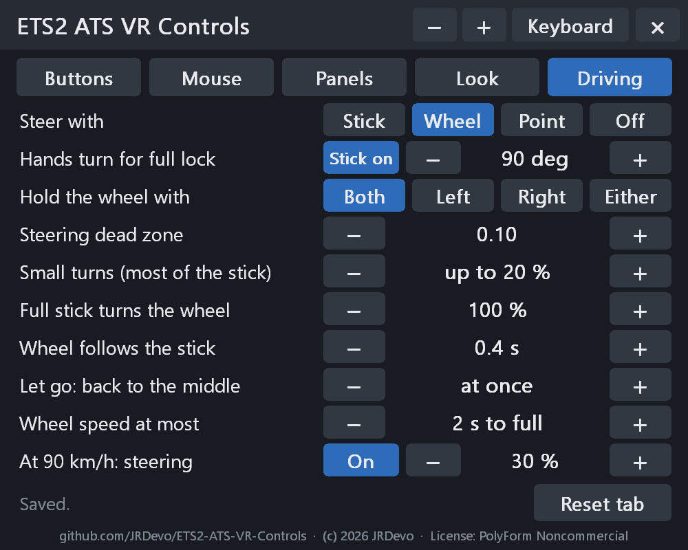 | 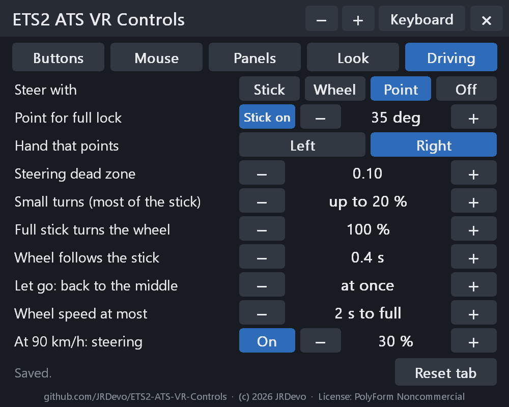 | 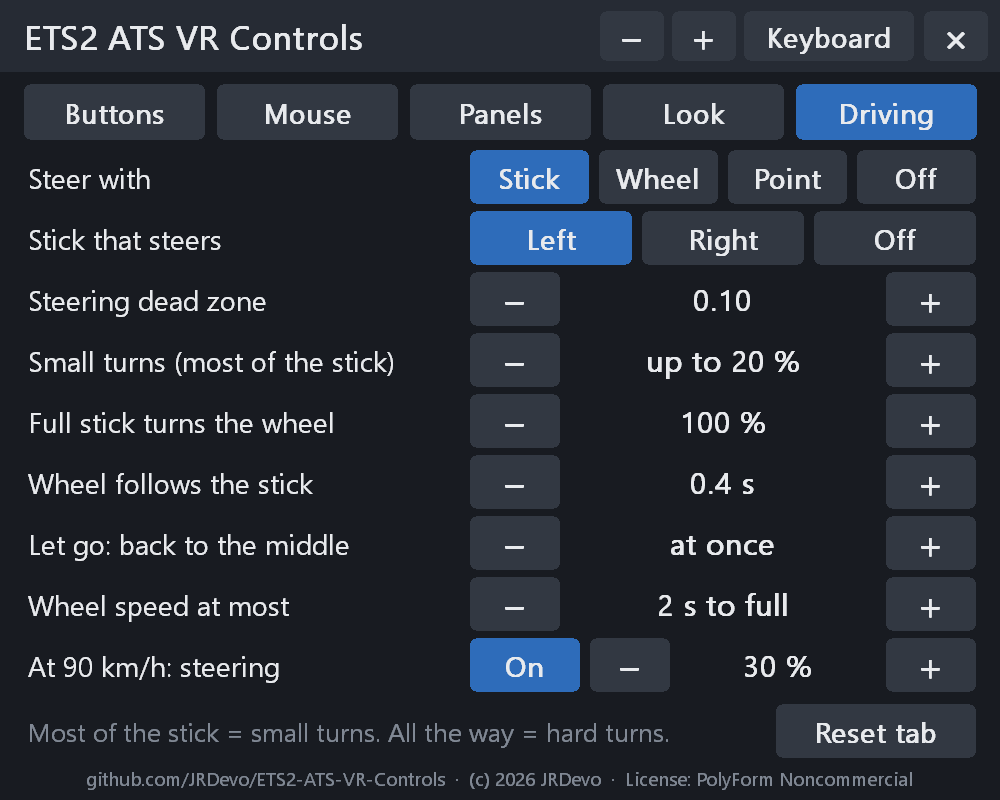 |

| Buttons tab: picking a key | Buttons tab: the Mod 1 layer (Normal / Mod 1 / Mod 2 / Both) | Mouse tab |
|---|---|---|
| 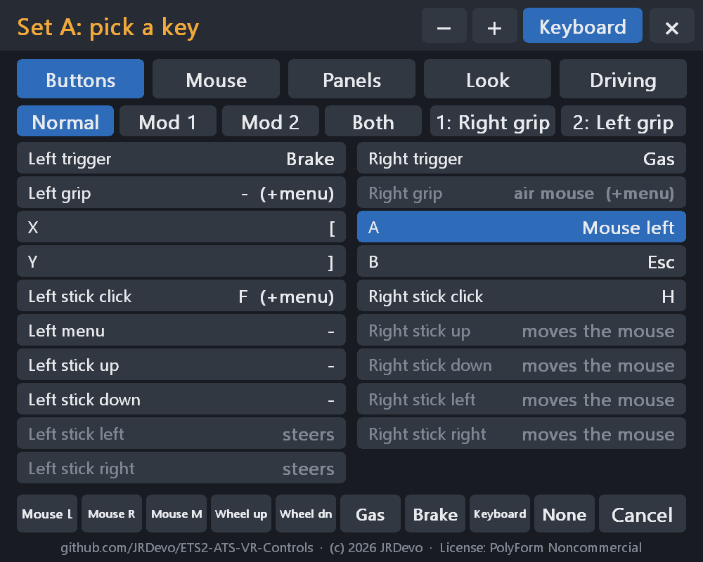 | 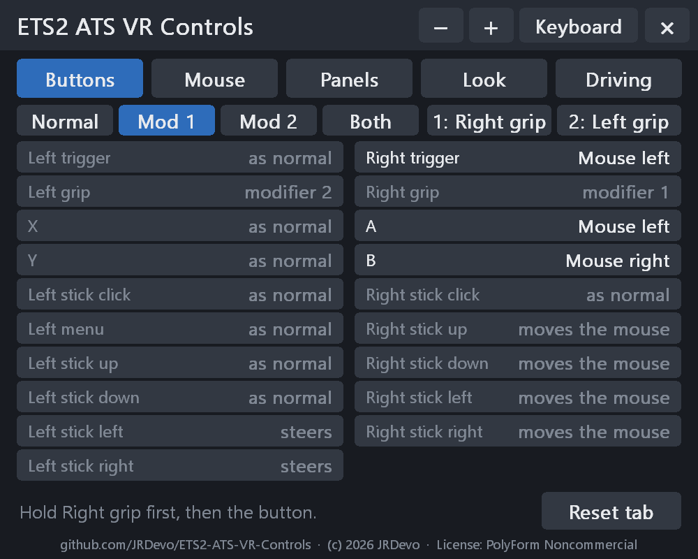 | 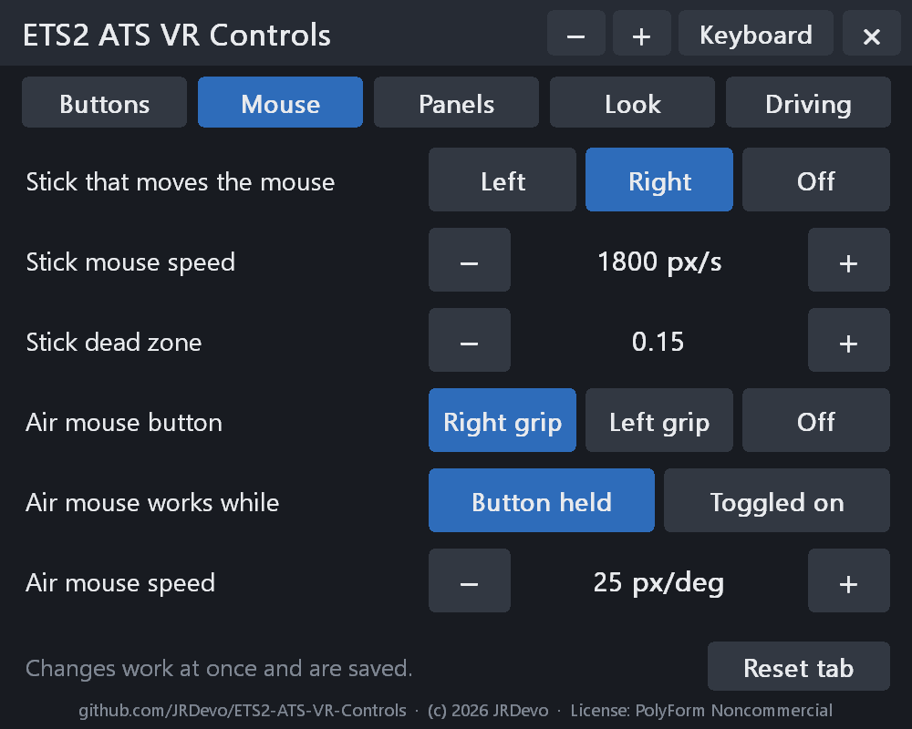 |

| Panels tab | Look tab | The keyboard |
|---|---|---|
| 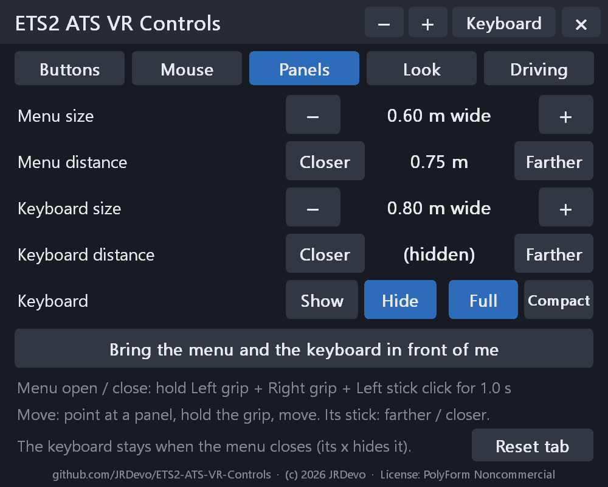 | 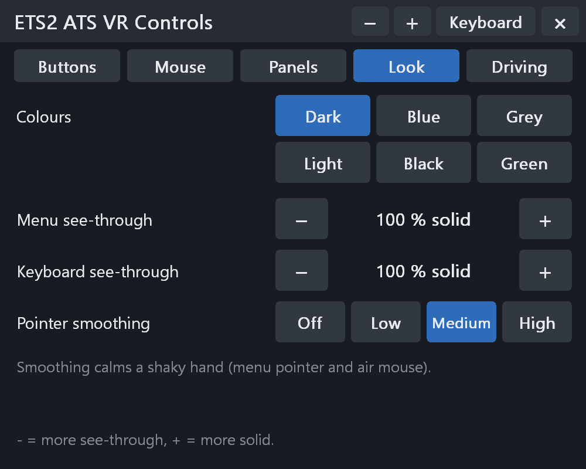 | 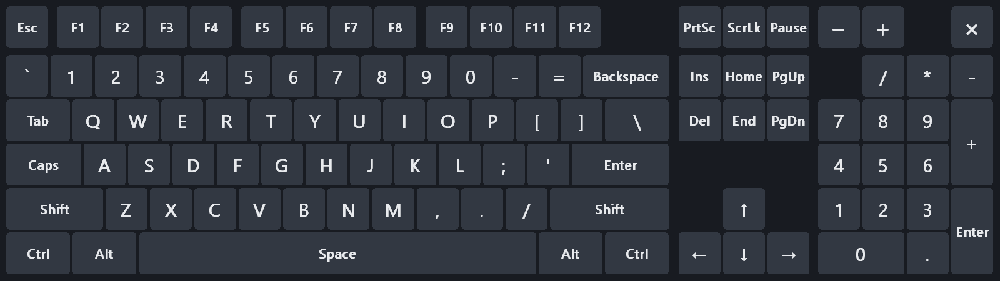 |

| Pointing at a setting: its help at the bottom | The compact keyboard (Panels tab > Compact) |
|---|---|
| 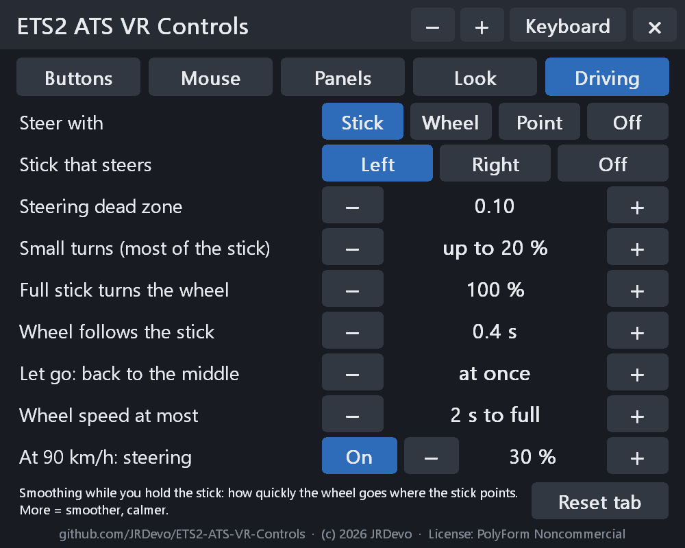 | 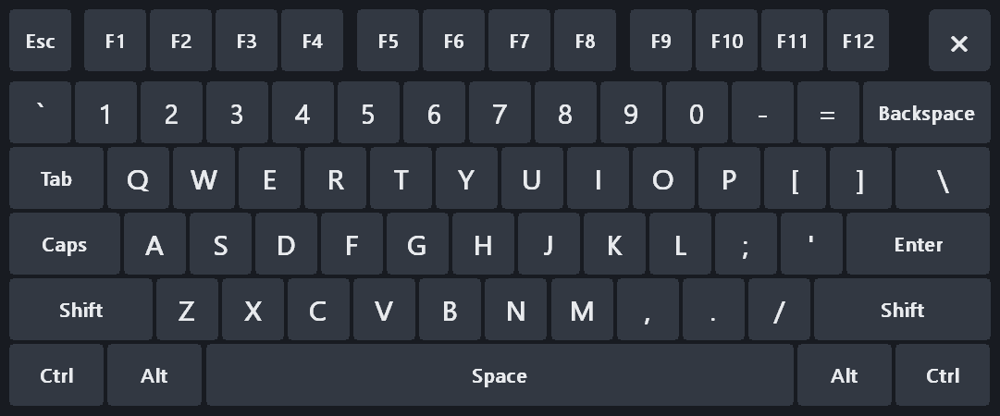 |

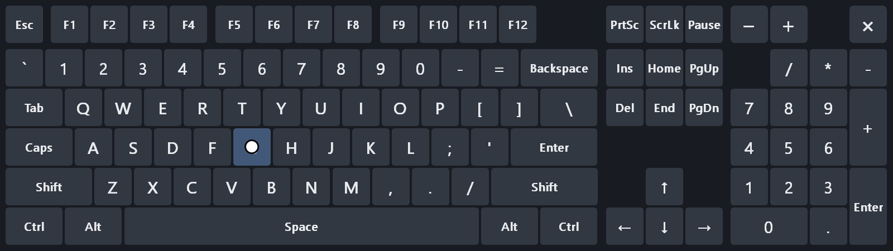

**Menu:** [Screenshots](#screenshots) · [Which VR mode?](#which-vr-mode) · [What it does](#what-it-does) · [Default buttons](#default-buttons) · [Driving](#driving-with-one-controller) · [VR menu](#the-vr-menu) · [Install](#install) · [Privacy](#what-runs-when--privacy) · [Settings](#settings) · [Problems](#problems) · [Report a problem](#reporting-a-problem-what-to-upload) · [Build](#build-from-source) · [License](#license)

<a name="which-vr-mode"></a>
<details>
<summary><h2>Which VR mode?</h2></summary>

ETS2 / ATS have three VR modes, chosen by a launch option (Steam: right-click the game > Properties > Launch options).
This mod works **only** in the OpenXR one:

| Launch option | VR system | This mod |
|---|---|---|
| `-openxr` | OpenXR | **works** |
| `-openvr` | SteamVR's own system (OpenVR) | does not load |
| `-oculus` | Meta's old Oculus system | does not load |

SCS also recommends OpenXR: it is the only VR mode in the normal game builds (1.55+; there, also add `-experimental_vr`),
while `-openvr` and `-oculus` exist only in the `oculus` beta branch on Steam.

How to use OpenXR with your headset:

- **Quest via Virtual Desktop:** `-openxr`, with Virtual Desktop's VDXR as the OpenXR runtime (Virtual Desktop sets it).
- **Quest via Link / Air Link:** `-openxr`, with the Meta Quest Link app as the OpenXR runtime (Meta app > Settings >
  General > OpenXR Runtime).
- **Valve Index, HTC Vive, Pico and other SteamVR headsets:** `-openxr`, with SteamVR as the OpenXR runtime (SteamVR >
  Settings > OpenXR > Set SteamVR as OpenXR runtime). The game then still runs through SteamVR.
- **Windows Mixed Reality:** `-openxr`, with the Windows Mixed Reality OpenXR runtime.

Only one OpenXR runtime is active at a time; the last one you set wins.


</details>

<a name="what-it-does"></a>
<details>
<summary><h2>What it does</h2></summary>

- Each controller button sends a key or a mouse button that you choose in `config.ini`.
- One stick moves the mouse pointer (the right stick by default).
- **Air mouse**: hold the right grip and turn the controller. The pointer follows, like a laser pointer. (Or set it to
  toggle: one press on, the next press off.)
- **Modifier**: while you hold the modifier button (right grip), buttons can send something else. Default: **right grip +
  A or right trigger = left click, right grip + B = right click** -- so one controller does everything: hold the grip (the
  pointer follows), press A or the trigger to click, hold B to right-click (drag the map). Set any button's modified key in the VR menu.
- **Two modifiers = four layers of buttons**: modifier 1 (right grip) and modifier 2 (left grip). No grip = your normal
  buttons; right grip held = layer 2; left grip held = layer 3; **both grips held = layer 4**. Hold the grip(s) first,
  then press the button. A button with nothing set in a layer does its normal job. (Both grips + the left stick click is
  the menu's own combo: that one never sends a key.)
- **Driving**: three ways to steer -- the left stick (default), a **wheel** you hold with one or both grips, or
  **pointing** a controller left / right. The right trigger is the gas pedal, the left trigger the brake. Smooth, not on /
  off keys. Gas and brake can go on any button. See [Driving](#driving-with-one-controller).
- **VR menu + keyboard**: hold both grips + the left stick click for 1 second. A menu opens in front of you. See [The VR menu](#the-vr-menu).
- The game's own VR controls (the trigger and the left menu button) still work.
- It only works in the games named in `config.ini`. In every other VR program it does nothing.
- It only sends input while the game window is in front. It never types into another program.

It is an OpenXR API layer: a small add-on that the VR system loads into the game. It does not change any game file, and it
works next to the ETS2 / ATS DLAA mod, VR EyeCapture, Virtual Desktop, OpenXR Toolkit and VectorXR.


</details>

<a name="default-buttons"></a>
<details>
<summary><h2>Default buttons</h2></summary>

Made so that **one controller (the right one) does the whole mouse**: point with the right stick or the air mouse, A =
left click, right grip + right trigger = left click too, right grip + B = right click. **Driving**: left stick =
steering, right trigger = gas, left trigger = brake.

| Controller | Sends | In ETS2 / ATS (default keys) |
|---|---|---|
| Right stick | moves the mouse pointer | |
| Right grip (hold) | air mouse (the pointer follows the controller), and the **modifier** | |
| A | left mouse click | click |
| Right grip + A | left mouse click | click while the air mouse aims |
| Right grip + B | right mouse click | drag the map: hold the grip, aim, hold B |
| Right grip + right trigger | left mouse click | click while the air mouse aims |
| Right trigger | **gas pedal** (press harder = more gas, let go = roll) | |
| B | Esc | menu / back |
| Left stick left / right | **steering** (stick half left = wheel half left; let go = straight again) | see [Driving](#driving-with-one-controller) |
| Left trigger | **brake** (press harder = more brake) | |
| X | `[` | left indicator |
| Y | `]` | right indicator |
| Right stick click | H | horn |
| Left stick click | F | hazard lights |
| Both grips + left stick click, 1 second | opens / closes the VR menu | |

(The right stick's arrow keys -- up / down / left / right -- work when you set the mouse to the left stick: Mouse tab.)

Change them in `config.ini`. If you changed the game's key bindings, change `config.ini` to match.

The game keeps its own menu button: the left menu button on every controller, B and Y on Valve Index, B on Vive and Windows
Mixed Reality. A key set for that button does nothing (the log says so).

Every other button is shared with other VR mods that watch it (for example VR EyeCapture's record combo, both stick
clicks): both react. If that is not what you want, set that button to `none` here or in the VR menu.

**Cab buttons:** the game has no clickable buttons in the cab, so pointing at a switch does nothing. Map the key of that
function to a controller button instead (for example `y = l` for the lights).


</details>

<a name="driving-with-one-controller"></a>
<details>
<summary><h2>Driving with the controllers</h2></summary>

By default:

| Controller | Does |
|---|---|
| Left stick left / right | steering. The wheel glides to where the stick is: a little push = a little turn, all the way = full turn. Ease the stick = less turn. Let go: the wheel glides back to straight. |
| Right trigger | gas pedal. Press a little = a little gas. Let go = the truck rolls (no gas). |
| Left trigger | brake. Press a little = a little brake. |
| Right grip + right trigger | left mouse click (not gas): hold the grip to aim with the air mouse, pull the trigger to click |

**You choose what drives.** Gas and brake are normal button choices, like a key:

- In the VR menu: Buttons tab, point at a button, then pick **Gas** or **Brake** in the bar at the bottom. Also with the
  modifiers ("Mod 1" / "Mod 2" / "Both": for example right grip + right trigger = brake).
- In `config.ini`: `rtrigger = brake`, `lgrip = brake`, `lup = gas` (stick forward), `modifier_keys = rtrigger:brake` ...
- Triggers and grips are analog (press harder = more). A stick direction too. Any other button (A, B, X, Y, stick click)
  is full gas / full brake.
- The steering stick: left, right or off (Driving tab, or `steer = left / right / off`). That stick's left / right then
  steer; its up / down are still free buttons (for example gas and brake).

**Three ways to steer** (Driving tab: **Steer with**, or `steer_with = stick / wheel / point`):

| Steer with | How | Full lock |
|---|---|---|
| **Stick** (default) | the stick, as below | the stick all the way |
| **Wheel** | hold the grips and turn your hands like a steering wheel: left hand up = turn right. **Hold the wheel with** both grips (default), the left, the right or either grip (`steer_wheel_grip`): with one hand, move it round the rim like a real wheel (right hand down = turn right). Let go: the wheel goes back to straight. The grab does not move the wheel, also when a second hand joins or lets go | 90 degrees of hand turn (`steer_wheel_angle`) |
| **Point** | point a controller left / right (**Hand that points**: left or right, `steer_point_hand`): straight ahead = straight. While you point at the VR menu or keyboard, or use the air mouse, the wheel **holds where it is** -- so you can type in a bend | 35 degrees left / right (`steer_point_angle`) |

- **Stick on / off** (next to the angle; `steer_stick_too`): on = the stick steers too (push it and it wins, let go and
  the hands steer again); off = only your hands steer, and the stick's left / right are normal buttons again.
- Wheel and Point are speed-sensitive like the stick (At 90 km/h, below). The wheel follows the hands at once (smoothed a
  little: `steer_aim_smooth`, 0.08 s), with no speed limit.
- **A grip that holds the wheel is only the wheel:** no key, no modifier layer, no air mouse, no gas / brake from it. With
  "Both", one grip alone keeps its own jobs; both together are the wheel (so no "Both" layer while steering with the
  wheel). With Left / Right / Either, that grip is always the wheel: the Buttons tab shows it as "the wheel", and a layer
  that needs it is greyed. Point with the other hand than the one you type with: the pointing hand steers on.
- `config.ini` only: `steer_point_button = x` (point steers only while X is held; set X itself to none),
  `steer_aim_deadzone` (degrees around straight that do not steer, 2).

**How the wheel moves:** the stick's place is where the wheel goes. The stick's throw is short, so it has two zones:
most of it (up to 80 % of a push) makes **small, careful turns** -- up to 20 % of the wheel, for following the road --, and
only the last bit, pushed **all the way to the edge**, makes **hard turns** up to full lock. While you hold the stick, the
wheel glides there: a small push turns it slowly, a full push fast, and a wobbling thumb is smoothed. Ease the stick a bit:
the wheel comes back to the new place and stays there. Let go: the wheel goes back to straight. If your thumb slips past the
middle as you let go, the wheel only goes straight, never past it.

**Steering feel** (Driving tab, or `config.ini`):

| Setting | What it does | Default |
|---|---|---|
| Steering dead zone (`steer_deadzone`) | how far the stick must move before the wheel turns | 0.10 |
| Small turns (most of the stick) (`steer_fine`, `steer_fine_zone`) | the stick's throw is short, so it has two zones. Most of it (the first 80 % of a push) makes small, careful turns for following the road: up to this much of the wheel. Only the last bit, at the edge, turns hard, up to full lock. Set it to "even (off)" for one even zone. 95 % of a push already counts as all the way (`steer_full_at`; many sticks stop there) | 20 % |
| Full stick turns the wheel (`steer_max`) | how far the wheel turns with the stick all the way | 100 % |
| Wheel follows the stick (`steer_follow_time`) | smoothing while you hold the stick: how quickly the wheel goes to the stick's place, in seconds (when standing; calmer at speed by itself). More = smoother and calmer | 0.4 s |
| Let go: back to the middle (`steer_center_time`) | how the wheel comes back when you let go. At once = at the wheel speed below (the default). More = a slow glide, in seconds | at once |
| Wheel speed at most (`steer_max_speed`) | the fastest the wheel turns, with the stick pushed all the way (a small push turns it slower): seconds from straight to full lock (in config.ini: full turns per second, 0.5 = 2 s). Slower at speed too | 2 s |
| Wheel speed back to straight (`steer_back_speed`, config.ini only) | the fastest the wheel goes back toward straight: when you let go, or push the stick the other way (a quick swing from one side to the other). Full turns per second (2 = 0.5 s from full lock to straight; 0 = no limit). Slower at speed too | 2 |
| At 90 km/h (`steer_speed_sens`, `steer_at_speed`) | **speed-sensitive steering**, On / Off: up to 10 km/h the stick steers fully; at 90 km/h and faster full stick turns the wheel only this much (30 %), so small moves are fine. A bend you hold while you speed up stays | On, 30 % |

Too twitchy at speed? Lower "At 90 km/h". Too twitchy everywhere? Make "Wheel follows the stick" slower (more seconds) or
"Wheel speed at most" slower. Small turns too big or too small? Change "Small turns". The wheel comes back too fast?
Give "Let go: back to the middle" some seconds.

**Not sure what a setting does?** In the VR menu, point at it (or at its name): the line at the bottom of the menu says what
it does.

**Switch driving off:** Driving tab > Driving: **Off** (or `drive = 0`). Then nothing steers, the gas / brake buttons do
nothing, and the steering stick's left / right send their keys again. **On** brings it all back.

It is smooth, like a gamepad: not on / off keys. How: ETS2 and ATS have their own door for input add-ons (the SCS input
SDK). This mod is also such an add-on, so the game gets the stick and the triggers directly. **No driver**, no fake gamepad,
no file in the game folder, and **nothing to set in the game's options** (it works next to your wheel, keyboard or gamepad
settings). `install.ps1` tells the game where the mod is (see [What install.ps1 does](#what-installps1-does-and-why-there-is-one)).

- **The game shows a note at every start**: "Request to use advanced SDK features detected". That is this mod. Point at
  **OK** and click (A or the right trigger). SCS shows it for every add-on that uses their SDK; as far as we know, a mod
  cannot hide it.

  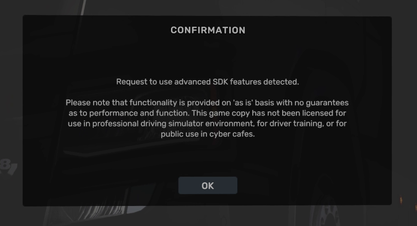
- `steer = off` and no gas / brake buttons: nothing drives, but the game still loads the add-on (so the VR menu can change
  it at once). To remove it completely, run `uninstall.ps1`.
- It works in every OpenXR mode and headset (Virtual Desktop, Link, SteamVR, Windows MR): the driving part does not depend
  on the headset at all.


</details>

<a name="the-vr-menu"></a>
<details>
<summary><h2>The VR menu</h2></summary>

Hold **both grips**, then press and hold the **left stick click**, for 1 second. The menu opens in front of you. Do it again
to close it. (Grips first: the left stick click alone is still the hazard lights.) It is not both stick clicks, because
VR EyeCapture starts a recording on that.

### Two different pointers (read this first)

There are **two** pointers, and only one of them works on the menu and the keyboard:

| | The game's mouse pointer | The VR pointer (white dot) |
|---|---|---|
| What it is | Windows' mouse arrow, inside the game's own screens | A white dot that this mod draws on its own panels |
| How it moves | The right stick, or the **air mouse**: hold the **right grip** and turn the controller | Just **point** a controller at the menu or the keyboard. No button needed. |
| Where it works | Only inside the game's picture (game menus, map, ...). It can **not** reach the VR menu or keyboard. | Only on the VR menu and the keyboard |
| How it clicks | A = left click, right grip + B = right click | **Trigger** while the dot is on a key / button |

So for the menu and the keyboard: **do not use the air mouse** (do not hold the grip). Aim the controller at the panel like
a laser pointer. A **white dot** appears where you point, and the key under it lights up. Then pull the trigger.


(While a controller points at a panel, its grip does not start the air mouse, and the game does not get its trigger.)

- **Point** with either controller. A white dot shows where. **Pull the trigger** to press.
- **Not sure what something does?** Point at it (or at its name on the left): the line at the bottom of the menu explains it.
  While you point at the menu, the game does not get that trigger.
- **Buttons** tab: every controller button and what it sends. Point at one, pull the trigger, then press a key on the
  keyboard (or pick Mouse L / Mouse R / Wheel / None at the bottom). For Shift + F: press Shift, then F.
  **Normal / Mod 1 / Mod 2 / Both** at the top: the layer the rows show and set -- what each button sends while modifier 1,
  modifier 2 or both are held ("as normal" = no entry). **1: ...** and **2: ...** pick the two modifier buttons (each
  press: the next button, or off).
- **Mouse** tab: which stick moves the mouse, its speed and dead zone, the air mouse button, hold or toggle, its speed.
- **Panels** tab: menu size, keyboard size, show / hide the keyboard, bring both in front of you.
- **Panels** tab also: the distance of each panel (Closer / Farther).
- **Driving** tab: **Steer with** Stick / Wheel / Point / Off; for Wheel and Point the hand angle for full lock, Stick on /
  off, and which grips hold the wheel (Both / Left / Right / Either) or which hand points (Left / Right); for the stick
  the stick that steers, the dead zone, small turns, how far the wheel turns, how quickly it follows the stick and comes
  back, its top speed; and speed-sensitive steering. Gas and brake: any button, Buttons tab. See [Driving](#driving-with-one-controller).
- **Look** tab: colours (Dark, Blue, Grey, Light, Black, Green), how see-through the menu and the keyboard are, and
  **pointer smoothing** (Off / Low / Medium / High): calms a shaky hand, for the menu pointer and the air mouse.
- **Reset tab** (bottom right of every tab): puts that tab's settings back to the defaults. Press it twice (the first
  press asks "Sure?"). Only that tab changes. On the Panels tab it also brings the menu (and the keyboard, if it is shown) in front of you.
- **Keyboard** (button at the top of the menu): a full keyboard with F-keys, arrows and number pad. A key goes down when
  you pull the trigger and up when you let go. Shift, Ctrl and Alt stay on for the next key.
  **A button for the keyboard:** Buttons tab, point at a button, pick **Keyboard** in the bottom bar. Then that button
  shows / hides the keyboard (`y = keyboard` in `config.ini`; it needs the VR menu on: `vr_menu = 1`). The keyboard **stays** when the menu closes, also at the next game start (put it at the side of your cab). Its x hides it.
  **Full or Compact** (Panels tab): Compact has only the main keys (Esc / F-keys down to Enter, Shift, Ctrl), with its
  only an x (above Backspace) to hide it: about 30 % narrower. Its size: Panels tab > Keyboard size.
- **Move** a panel: point at it, **hold the grip** and move the controller. While you hold it, push that controller's stick
  up / down to move it farther / closer. **Size**: the - and + at the top.

Every change works at once and is saved in `config.ini`. The menu uses no keyboard key, so it never clashes with the
ETS2 / ATS DLAA mod's menu (`Delete`). The menu and keyboard float in the room: after a recenter they move with it.


</details>

<a name="install"></a>
<details>
<summary><h2>Install</h2></summary>

1. Download `ETS2-ATS-VR-Controls-v0.2.0.zip` from the [Releases](../../releases) page. Close the game.
2. Unzip the folder to a place where it can stay (for example `C:\ETS2 ATS VR Controls`).
3. Right-click `install.ps1` > **Run with PowerShell**. Click **Yes** in the Windows admin prompt.
   (Admin is needed: ETS2 / ATS only load VR add-ons that are registered for all users.)
4. Start the game in VR.

Uninstall: run `uninstall.ps1` the same way. Then you can delete the folder.

<a name="what-installps1-does-and-why-there-is-one"></a>
<details>
<summary><h3>What <code>install.ps1</code> does, and why there is one</h3></summary>

**Why a script?** This mod is not a game mod (`.scs` file) and does not go into the game folder. It is an *OpenXR API
layer*: a small add-on that the VR system (OpenXR) loads into the game when the game starts VR. OpenXR finds add-ons through
**one entry in the Windows registry**. For driving, the same DLL is also the game's own kind of input add-on, and the game
finds those through **one registry entry per game**. The script writes these entries for you, so you do not have to edit
the registry by hand.

**What it installs:** nothing is copied into Windows or into the game. It writes three registry values:

| Where | Name | Value |
|---|---|---|
| `HKEY_LOCAL_MACHINE\SOFTWARE\Khronos\OpenXR\1\ApiLayers\Implicit` | the full path of `XR_APILAYER_JRDEVO_ets2_ats_vr_controls.json` in your mod folder | `0` (= switched on) |
| `HKEY_LOCAL_MACHINE\SOFTWARE\SCS Software\Euro Truck Simulator 2\Plugins` | `ets2_ats_vr_controls` | the full path of `ets2_ats_vr_controls.dll` (driving) |
| `HKEY_LOCAL_MACHINE\SOFTWARE\SCS Software\American Truck Simulator\Plugins` | `ets2_ats_vr_controls` | the same (driving) |

The `.json` file tells OpenXR the add-on's name and where `ets2_ats_vr_controls.dll` is (next to it). That is why the folder
must stay where you unzipped it: the registry points to it.

**How it works, step by step:**

1. It stops if ETS2 or ATS is running (the DLL would be in use).
2. It removes an old per-user entry of this mod, if there is one (that would load the mod twice).
3. It asks for admin rights: you see one Windows prompt (UAC). This is needed because the entry is under
   `HKEY_LOCAL_MACHINE` (for all users): the OpenXR loader built into ETS2 / ATS only looks there.
4. It removes an older entry of this mod from another folder (if you moved the folder), then writes the new one. The same
   for the two driving entries (the keys are made if they are missing, so a game you install later finds it too).
5. Done. The next time the game starts VR, OpenXR loads the mod. In every other VR game the mod does nothing (see `apps`
   in `config.ini`).

`uninstall.ps1` removes these registry entries again (also with one admin prompt). Your files and `config.ini` stay; delete
the folder yourself if you like. You can check the entries yourself with `regedit` at the paths above.

**"Run with PowerShell" is not there, or Windows blocks the script?** Open PowerShell in the mod folder and run:

```
powershell -ExecutionPolicy Bypass -File .\install.ps1
```


</details>

</details>

<a name="what-runs-when--privacy"></a>
<details>
<summary><h2>What runs when / privacy</h2></summary>

- **Nothing runs in the background.** No service, no tray icon, no startup entry. With no VR game running, Task Manager
  shows nothing from this mod.
- **It only starts with a VR game.** The game's own VR system (OpenXR) loads it when the game starts VR, the same way it
  loads OpenXR Toolkit or other VR add-ons. When the game closes, the mod is gone too.
- **Other VR games:** it checks the game's name once at start (less than a millisecond), then switches itself off for the
  rest of that game: no work, no log, no buttons. (The small DLL stays in that game's memory until it closes.)
- **No internet.** It never connects anywhere.
- **Only its own files:** it reads `config.ini` and writes its own log and the settings you change in its menu.
- **Keys only to the game:** it sends keys / mouse only while the game window is in front. It does not look at other
  programs or at what you type outside the game.
- **One install, both games:** the registry entry is for the whole PC, so it works in ETS2 and ATS (the `apps` line in
  `config.ini` lists both). All of the source code is in this repository.


</details>

<a name="settings"></a>
<details>
<summary><h2>Settings</h2></summary>

Use the VR menu, or open `config.ini` in Notepad. Every setting is explained in the file. Restart the game after a change
in Notepad (the VR menu's changes work at once).

Button names: `ltrigger rtrigger lgrip rgrip x y a b lstick rstick menu lup ldown lleft lright rup rdown rleft rright`.
Values: a key (`h`, `f1`, `space`, `[`), up to 3 keys with `+` (`shift+f`), `mouse_left`, `mouse_right`, `mouse_middle`,
`wheel_up`, `wheel_down`, `gas`, `brake` (driving), `keyboard` (shows / hides the VR keyboard) or `none`.


</details>

<a name="problems"></a>
<details>
<summary><h2>Problems</h2></summary>

The log is `logs\ets2_ats_vr_controls.log` next to the DLL. It says which controller the VR system uses, which buttons are mapped,
and every problem. The log is **off by default** (no file, nothing measured: the lightest). Set `log = 1` in `config.ini`
to write it, and also `log_inputs = 1` to see every key the layer sends.

<a name="reporting-a-problem-what-to-upload"></a>
### Reporting a problem (what to upload)

1. In `config.ini` (next to `ets2_ats_vr_controls.dll`) set `log = 1` (and `log_inputs = 1` if a button does the wrong thing).
2. Start the game in VR and do what goes wrong for 1 to 2 minutes.
3. Quit the game.
4. Open a [bug report](../../issues/new/choose) and drag `logs\ets2_ats_vr_controls.log` and `config.ini` into it.


</details>

<a name="build-from-source"></a>
<details>
<summary><h2>Build from source</h2></summary>

Visual Studio 2022 (C++), CMake 3.20+. The OpenXR SDK is downloaded on the first configure.

```
cmake -B build -S . -G "Visual Studio 17 2022" -A x64
cmake --build build --config Release
powershell -ExecutionPolicy Bypass -File tests\run_unit.ps1
powershell -ExecutionPolicy Bypass -File tests\run_e2e.ps1
```

`tests\run_e2e.ps1` runs a fake game through the real OpenXR loader, this layer and a fake VR runtime with scripted button
presses. No headset is needed, and no real key presses are sent.


</details>

<a name="license"></a>
<details>
<summary><h2>License</h2></summary>

PolyForm Noncommercial 1.0.0, see `LICENSE.md`.

</details>
