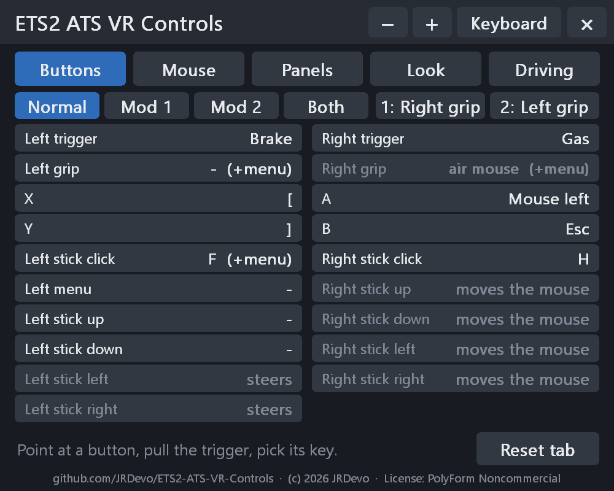

# ETS2 ATS VR Controls

Use your VR controllers as a keyboard and mouse in **Euro Truck Simulator 2** and **American Truck Simulator** (OpenXR VR).
Press a controller button, and the game gets a key press. Move a stick or point the controller, and the mouse pointer moves.

> Status: v0.2.0. Phase 1 (buttons, pointer and click) works in the game. New in v0.2.0 (phase 2): **a VR menu and a full
> keyboard in the headset** -- tested with a fake game and a fake VR runtime, **not in the real game yet**. Planned: phase 3,
> single buttons you place anywhere (for example over a cab switch) that press a key.

## What it does

- Each controller button sends a key or a mouse button that you choose in `config.ini`.
- One stick moves the mouse pointer (the left stick by default).
- **Air mouse**: hold the right grip and turn the controller. The pointer follows, like a laser pointer. (Or set it to
  toggle: one press on, the next press off.)
- **VR menu + keyboard**: hold both grips + the left stick click for 1 second. A menu opens in front of you. See [The VR menu](#the-vr-menu).
- The game's own VR controls (the trigger and the left menu button) still work.
- It only works in the games named in `config.ini`. In every other VR program it does nothing.
- It only sends input while the game window is in front. It never types into another program.

It is an OpenXR API layer: a small add-on that the VR system loads into the game. It does not change any game file, and it
works next to the ETS2 / ATS DLAA mod, VR EyeCapture, Virtual Desktop, OpenXR Toolkit and VectorXR.

## Default buttons

| Controller | Sends | In ETS2 / ATS (default keys) |
|---|---|---|
| Right trigger | left mouse click | click |
| Left trigger | right mouse click | |
| Right grip (hold) | air mouse | |
| A | Enter | |
| B | Esc | menu / back |
| X | `[` | left indicator |
| Y | `]` | right indicator |
| Right stick click | H | horn |
| Left stick click | F | hazard lights |
| Both grips + left stick click, 1 second | opens / closes the VR menu | |
| Right stick up / down / left / right | arrow keys | |
| Left stick | moves the mouse pointer | |

Change them in `config.ini`. If you changed the game's key bindings, change `config.ini` to match.

The game keeps its own menu button: the left menu button on every controller, B and Y on Valve Index, B on Vive and Windows
Mixed Reality. A key set for that button does nothing (the log says so).

Every other button is shared with other VR mods that watch it (for example VR EyeCapture's record combo, both stick
clicks): both react. If that is not what you want, set that button to `none` here or in the VR menu.

**Cab buttons:** the game has no clickable buttons in the cab, so pointing at a switch does nothing. Map the key of that
function to a controller button instead (for example `y = l` for the lights).

## The VR menu

Hold **both grips**, then press and hold the **left stick click**, for 1 second. The menu opens in front of you. Do it again
to close it. (Grips first: the left stick click alone is still the hazard lights.) It is not both stick clicks, because
VR EyeCapture starts a recording on that.

### Two different pointers (read this first)

There are **two** pointers, and only one of them works on the menu and the keyboard:

| | The game's mouse pointer | The VR pointer (white dot) |
|---|---|---|
| What it is | Windows' mouse arrow, inside the game's own screens | A white dot that this mod draws on its own panels |
| How it moves | The left stick, or the **air mouse**: hold the **right grip** and turn the controller | Just **point** a controller at the menu or the keyboard. No button needed. |
| Where it works | Only inside the game's picture (game menus, map, ...). It can **not** reach the VR menu or keyboard. | Only on the VR menu and the keyboard |
| How it clicks | Right trigger = left mouse click | **Trigger** while the dot is on a key / button |

So for the menu and the keyboard: **do not use the air mouse** (do not hold the grip). Aim the controller at the panel like
a laser pointer. A **white dot** appears where you point, and the key under it lights up. Then pull the trigger.


(While a controller points at a panel, its grip does not start the air mouse, and the game does not get its trigger.)

- **Point** with either controller. A white dot shows where. **Pull the trigger** to press.
  While you point at the menu, the game does not get that trigger.
- **Buttons** tab: every controller button and what it sends. Point at one, pull the trigger, then press a key on the
  keyboard (or pick Mouse L / Mouse R / Wheel / None at the bottom). For Shift + F: press Shift, then F.
- **Mouse** tab: which stick moves the mouse, its speed and dead zone, the air mouse button, hold or toggle, its speed.
- **Panels** tab: menu size, keyboard size, show / hide the keyboard, bring both in front of you.
- **Panels** tab also: the distance of each panel (Closer / Farther).
- **Look** tab: colours (Dark, Blue, Grey, Light, Black, Green), how see-through the menu and the keyboard are, and
  **pointer smoothing** (Off / Low / Medium / High): calms a shaky hand, for the menu pointer and the air mouse.
- **Keyboard** (button at the top of the menu): a full keyboard with F-keys, arrows and number pad. A key goes down when
  you pull the trigger and up when you let go. Shift, Ctrl and Alt stay on for the next key.
  The keyboard **stays** when the menu closes, also at the next game start (put it at the side of your cab). Its x hides it.
  **Full or Compact** (Panels tab): Compact has only the main keys (Esc / F-keys down to Enter, Shift, Ctrl), with its
  only an x (above Backspace) to hide it: about 30 % narrower. Its size: Panels tab > Keyboard size.
- **Move** a panel: point at it, **hold the grip** and move the controller. While you hold it, push that controller's stick
  up / down to move it farther / closer. **Size**: the - and + at the top.

Every change works at once and is saved in `config.ini`. The menu uses no keyboard key, so it never clashes with the
ETS2 / ATS DLAA mod's menu (`Delete`). The menu and keyboard float in the room: after a recenter they move with it.

### Screenshots

| Buttons tab: picking a key | Mouse tab | The keyboard |
|---|---|---|
|  |  |  |

The compact keyboard (Panels tab > Compact):


## Install

1. Close the game.
2. Unzip the folder to a place where it can stay (for example `C:\ETS2 ATS VR Controls`).
3. Right-click `install.ps1` > **Run with PowerShell**. Click **Yes** in the Windows admin prompt.
   (Admin is needed: ETS2 / ATS only load VR add-ons that are registered for all users.)
4. Start the game in VR.

Uninstall: run `uninstall.ps1` the same way. Then you can delete the folder.

### What `install.ps1` does, and why there is one

**Why a script?** This mod is not a game mod (`.scs` file) and does not go into the game folder. It is an *OpenXR API
layer*: a small add-on that the VR system (OpenXR) loads into the game when the game starts VR. OpenXR finds add-ons through
**one entry in the Windows registry**. The script writes that one entry for you, so you do not have to edit the registry
by hand.

**What it installs:** nothing is copied into Windows or into the game. It writes exactly one registry value:

| Where | Name | Value |
|---|---|---|
| `HKEY_LOCAL_MACHINE\SOFTWARE\Khronos\OpenXR\1\ApiLayers\Implicit` | the full path of `XR_APILAYER_JRDEVO_ets2_ats_vr_controls.json` in your mod folder | `0` (= switched on) |

The `.json` file tells OpenXR the add-on's name and where `ets2_ats_vr_controls.dll` is (next to it). That is why the folder
must stay where you unzipped it: the registry points to it.

**How it works, step by step:**

1. It stops if ETS2 or ATS is running (the DLL would be in use).
2. It removes an old per-user entry of this mod, if there is one (that would load the mod twice).
3. It asks for admin rights: you see one Windows prompt (UAC). This is needed because the entry is under
   `HKEY_LOCAL_MACHINE` (for all users): the OpenXR loader built into ETS2 / ATS only looks there.
4. It removes an older entry of this mod from another folder (if you moved the folder), then writes the new one.
5. Done. The next time the game starts VR, OpenXR loads the mod. In every other VR game the mod does nothing (see `apps`
   in `config.ini`).

`uninstall.ps1` removes that registry entry again (also with one admin prompt). Your files and `config.ini` stay; delete
the folder yourself if you like. You can check the entry yourself with `regedit` at the path above.

**"Run with PowerShell" is not there, or Windows blocks the script?** Open PowerShell in the mod folder and run:

```
powershell -ExecutionPolicy Bypass -File .\install.ps1
```

## Settings

Use the VR menu, or open `config.ini` in Notepad. Every setting is explained in the file. Restart the game after a change
in Notepad (the VR menu's changes work at once).

Button names: `ltrigger rtrigger lgrip rgrip x y a b lstick rstick menu lup ldown lleft lright rup rdown rleft rright`.
Values: a key (`h`, `f1`, `space`, `[`), up to 3 keys with `+` (`shift+f`), `mouse_left`, `mouse_right`, `mouse_middle`,
`wheel_up`, `wheel_down` or `none`.

## Problems

The log is `logs\ets2_ats_vr_controls.log` next to the DLL. It says which controller the VR system uses, which buttons are mapped,
and every problem. Set `log_inputs = 1` in `config.ini` to see every key the layer sends.

<a name="reporting-a-problem-what-to-upload"></a>
### Reporting a problem (what to upload)

1. In `config.ini` (next to `ets2_ats_vr_controls.dll`) set `log_inputs = 1`.
2. Start the game in VR and do what goes wrong for 1 to 2 minutes.
3. Quit the game.
4. Open a [bug report](../../issues/new/choose) and drag `logs\ets2_ats_vr_controls.log` and `config.ini` into it.

## Build from source

Visual Studio 2022 (C++), CMake 3.20+. The OpenXR SDK is downloaded on the first configure.

```
cmake -B build -S . -G "Visual Studio 17 2022" -A x64
cmake --build build --config Release
powershell -ExecutionPolicy Bypass -File tests\run_unit.ps1
powershell -ExecutionPolicy Bypass -File tests\run_e2e.ps1
```

`tests\run_e2e.ps1` runs a fake game through the real OpenXR loader, this layer and a fake VR runtime with scripted button
presses. No headset is needed, and no real key presses are sent.

## License

PolyForm Noncommercial 1.0.0, see `LICENSE.md`.
