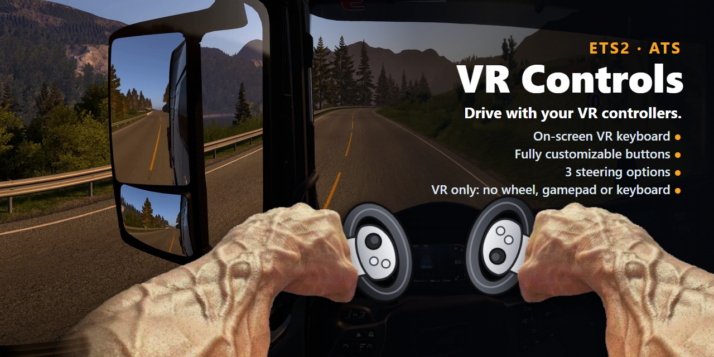

<!-- Short README in Ελληνικά. The full guide (English): ../../README.md -->
# ETS2 ATS VR Controls: οδηγήστε το Euro Truck Simulator 2 και το American Truck Simulator σε VR με τα χειριστήρια VR σας

> [!CAUTION]
> **Κατεβάστε αυτό το mod μόνο από https://github.com/JRDevo/ETS2-ATS-VR-Controls/releases.** Δεν υπάρχει ιστοσελίδα, ούτε Discord,
> ούτε Nexus, ούτε Steam Workshop. Κάθε άλλος ιστότοπος, καθρέφτης ή «πρόγραμμα εγκατάστασης» που το προσφέρει δεν είναι δικό μου: μην το εκτελέσετε.

Παίξτε **Euro Truck Simulator 2** και **American Truck Simulator** σε VR **μόνο με το headset και τα χειριστήριά του**. Χωρίς
τιμόνι, χωρίς gamepad, χωρίς πληκτρολόγιο, χωρίς ποντίκι.

- **Οδηγήστε με τα χειριστήρια:** στρίψτε με τον μοχλό, με ένα τιμόνι που κρατάτε με ένα ή και με τα δύο χέρια, ή δείχνοντας. Οι
  σκανδάλες είναι το γκάζι και το φρένο.
- **Κάθε πλήκτρο σε ένα κουμπί:** φλας, κόρνα, φώτα ... σε τέσσερα επίπεδα (κρατήστε μια λαβή για περισσότερα κουμπιά).
- **Ένα ποντίκι στο χέρι σας:** για τα μενού του παιχνιδιού και τον χάρτη.
- **Ένα πλήρες πληκτρολόγιο στο headset**, με τα πλήκτρα του πληκτρολογίου της χώρας σας.
- **Το μενού VR στη γλώσσα σας:** ακολουθεί μόνο του τη γλώσσα του παιχνιδιού.

## Τι χρειάζεστε

- Windows 10 / 11 (64-bit), ETS2 ή ATS και ένα headset VR (Quest, Index, Vive, Pico, Windows Mixed Reality ...).
- Το παιχνίδι σε λειτουργία VR **OpenXR**. Steam: δεξί κλικ στο παιχνίδι > Ιδιότητες > Επιλογές εκκίνησης: `-openxr`
  (στην κανονική έκδοση του παιχνιδιού και `-experimental_vr`). Οι λειτουργίες `-openvr` και `-oculus` δεν λειτουργούν με αυτό το mod.

## Εγκατάσταση

1. Κατεβάστε το πιο πρόσφατο `ETS2-ATS-VR-Controls-Setup-....exe` από τη σελίδα
   [Releases](https://github.com/JRDevo/ETS2-ATS-VR-Controls/releases). Κλείστε το παιχνίδι.
2. Εκτελέστε το. Πατήστε **Ναι** στο μήνυμα διαχειριστή των Windows και μετά **Επόμενο** μέχρι το τέλος. Το mod εγκαθίσταται στο
   `C:\Program Files\ETS2 ATS VR Controls` (μπορείτε να επιλέξετε άλλον φάκελο). Οι ρυθμίσεις σας (`config.ini`) και τα αρχεία καταγραφής
   πηγαίνουν στο `C:\ProgramData\ETS2 ATS VR Controls`.
3. Ξεκινήστε το παιχνίδι σε VR.

Σε κάθε εκκίνηση το παιχνίδι εμφανίζει «Request to use advanced SDK features detected» (εντοπίστηκε αίτημα χρήσης προηγμένων λειτουργιών SDK). Αυτό είναι αυτό το mod (για την οδήγηση): στοχεύστε στο
OK και κάντε κλικ.

**Το μενού VR:** κρατήστε **και τις δύο λαβές + το κλικ του αριστερού μοχλού** για 1 δευτερόλεπτο. Εκεί ρυθμίζετε κάθε κουμπί, το ποντίκι,
το τιμόνι, τα χρώματα και τη γλώσσα.

Απεγκατάσταση: Windows **Ρυθμίσεις > Εφαρμογές > Εγκατεστημένες εφαρμογές > ETS2 ATS VR Controls > Κατάργηση εγκατάστασης**. Αφαιρεί το
mod, τις καταχωρίσεις μητρώου του και τα αρχεία καταγραφής. Ρωτά αν πρέπει να διαγράψει και τις ρυθμίσεις σας (Όχι = κρατήστε τες για μελλοντική εγκατάσταση).

Χωρίς το πρόγραμμα εγκατάστασης: το `.zip` στην ίδια σελίδα περιέχει `install.ps1` και `uninstall.ps1` (δείτε τον πλήρη οδηγό).

## Περισσότερα

- **Ο πλήρης οδηγός** (στα αγγλικά): [README](../../README.md).
- Πρόβλημα; [Αναφέρετε ένα σφάλμα](https://github.com/JRDevo/ETS2-ATS-VR-Controls/issues/new/choose).
- Λάθος λέξη στη γλώσσα σας; [Αναφέρετε πρόβλημα μετάφρασης](https://github.com/JRDevo/ETS2-ATS-VR-Controls/issues/new?template=translation.yml).

*Αυτή η σελίδα μεταφράστηκε με τεχνητή νοημοσύνη. Η βοήθεια από native speakers είναι ευπρόσδεκτη.* Άδεια χρήσης: PolyForm Noncommercial 1.0.0.
